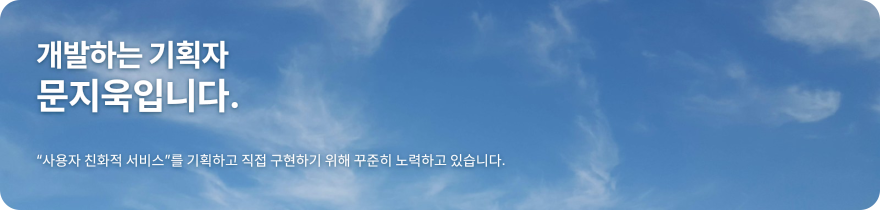
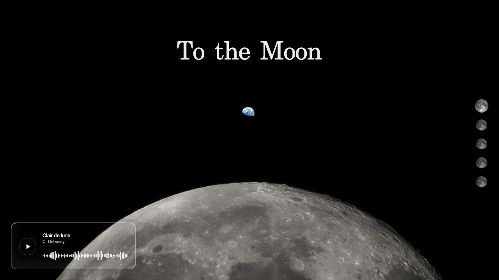
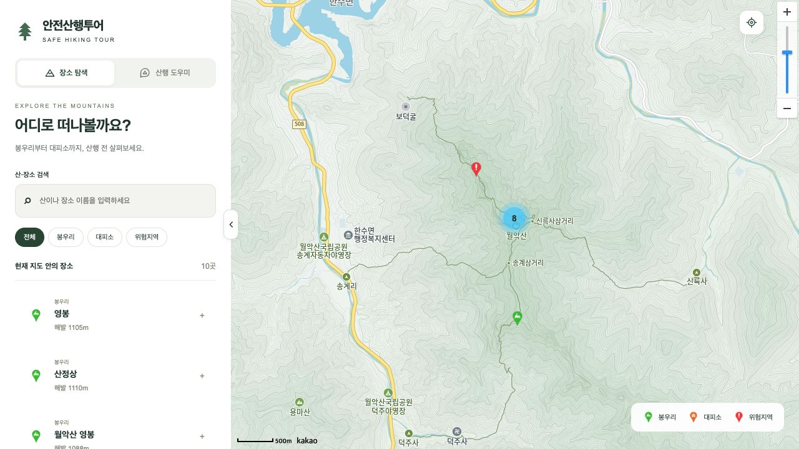

<picture>
  <source media="(max-width: 600px)" srcset="./assets/intro-sky-mobile.svg" />
  
</picture>

 

### Skills

| 분야 | 기술·도구 |
| :--- | :--- |
| **기획·협업** | Figma · Notion · Linear · Slack |
| **웹 개발** | React · Next.js · TypeScript · Node.js · Git |
| **데이터·자동화** | Python · SQL · Amplitude |
| **QA** | QA 정책·테스트 케이스 설계 · 이벤트 로깅 검증 |

 

### Selected Projects

<table>
  <tr>
    <td width="50%" valign="top">
      <a href="https://github.com/moonjiuk/to-the-moon">
        
        
<strong>To the Moon</strong>

        
달의 지형을 3D와 애니메이션으로 탐색하는 인터랙티브 웹사이트

      </a>
    </td>
    <td width="50%" valign="top">
      <a href="https://github.com/moonjiuk/safe-hiking-tour">
        
        
<strong>안전산행투어</strong>

        
등산 위험정보·대피소·봉우리를 한눈에 확인하는 지도 서비스

      </a>
    </td>
  </tr>
</table>
