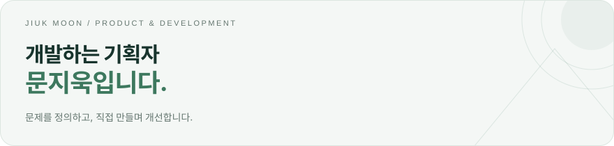
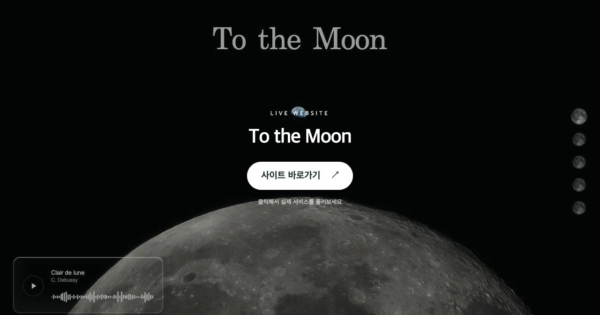
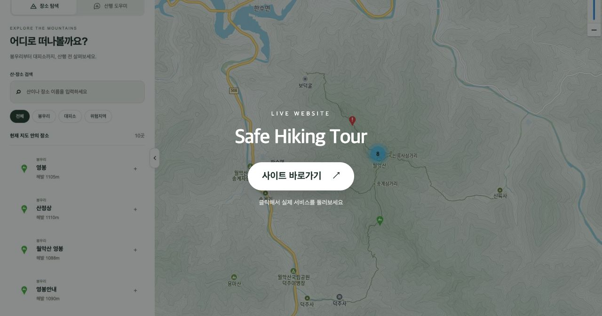

<picture>
  <source media="(prefers-color-scheme: dark) and (max-width: 600px)" srcset="./assets/intro-dark-mobile.svg" />
  <source media="(prefers-color-scheme: dark)" srcset="./assets/intro-dark.svg" />
  <source media="(max-width: 600px)" srcset="./assets/intro-light-mobile.svg" />
  
</picture>

 

### Skills

<b>PRODUCT & COLLABORATION</b>

  
  
  
  

<b>DEVELOPMENT</b>

  
  
  
  
  

<b>DATA & QA</b>

  
  
  
   
  QA 정책 · 테스트 케이스 설계 · 이벤트 로깅 검증

 

### Selected Projects

<table>
  <tr>
    <td width="50%" valign="top">
      
      <h3>To the Moon</h3>
      
달의 지형을 3D와 애니메이션으로 탐색하는 인터랙티브 웹사이트

      
3D 모델 · 글라스 뮤직 플레이어

      

        <a href="https://to-the-moon-ashen.vercel.app/">사이트 ↗</a> &nbsp;·&nbsp;
        <a href="https://github.com/moonjiuk/to-the-moon">코드 보기</a>
      

    </td>
    <td width="50%" valign="top">
      
      <h3>안전산행투어</h3>
      
등산 위험정보·대피소·봉우리를 한눈에 확인하는 지도 서비스

      
대량 마커 최적화 · 산행 도우미

      

        <a href="https://safe-hiking-tour.vercel.app/">사이트 ↗</a> &nbsp;·&nbsp;
        <a href="https://github.com/moonjiuk/safe-hiking-tour">코드 보기</a>
      

    </td>
  </tr>
</table>
