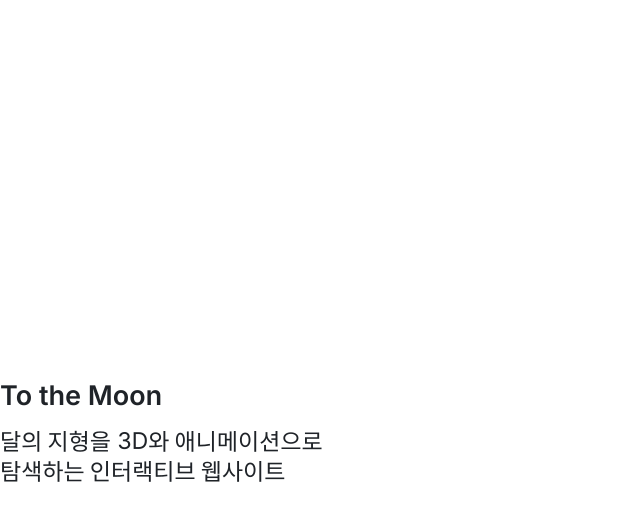
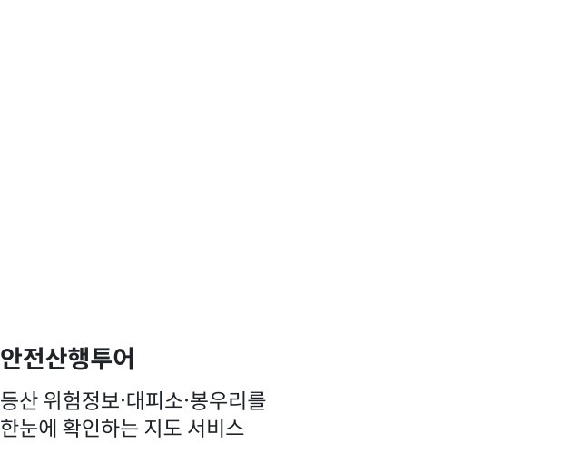

<picture>
  <source media="(max-width: 600px)" srcset="./assets/intro-sky-mobile.svg" />
  
</picture>

 

### 스킬

| 분야 | 기술·도구 |
| :--- | :--- |
| **기획·협업** |     |
| **웹 개발** |      |
| **데이터·자동화** |    |

 

### 프로젝트 링크

<table>
  <tr>
    <td width="50%" valign="top">
      <a href="https://github.com/moonjiuk/to-the-moon" title="To the Moon GitHub 저장소로 이동">
        <picture>
          <source media="(prefers-color-scheme: dark) and (max-width: 600px)" srcset="./assets/projects/to-the-moon-dark-mobile.svg" />
          <source media="(prefers-color-scheme: dark)" srcset="./assets/projects/to-the-moon-dark.svg" />
          <source media="(max-width: 600px)" srcset="./assets/projects/to-the-moon-light-mobile.svg" />
          
        </picture>
      </a>
    </td>
    <td width="50%" valign="top">
      <a href="https://github.com/moonjiuk/safe-hiking-tour" title="안전산행투어 GitHub 저장소로 이동">
        <picture>
          <source media="(prefers-color-scheme: dark) and (max-width: 600px)" srcset="./assets/projects/safe-hiking-tour-dark-mobile.svg" />
          <source media="(prefers-color-scheme: dark)" srcset="./assets/projects/safe-hiking-tour-dark.svg" />
          <source media="(max-width: 600px)" srcset="./assets/projects/safe-hiking-tour-light-mobile.svg" />
          
        </picture>
      </a>
    </td>
  </tr>
</table>
